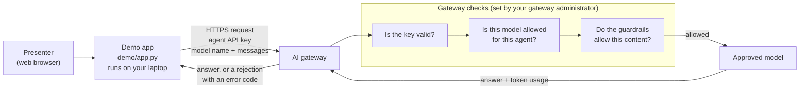

# Architecture

This demo has three parts: an app that runs on your laptop, the AI gateway, and the models behind it. The app never talks to a model directly. Every request goes to the gateway, and the gateway decides what happens next.

## What each part does

| Part | Runs where | Responsible for |
|---|---|---|
| **Demo app** (`demo/app.py`) | Your laptop | The chat screen, demo prompts, and risk tests. It also measures response time, estimates cost, and labels each result. |
| **Assistant instructions** (`demo/prompts.py`) | Sent with every request | How the assistant writes, and how it handles injected instructions and personal data. This is the second layer of defense, after the gateway. |
| **AI gateway** | The organization's cloud | Checks the key, enforces which models each agent may use, applies guardrails, and records usage. Its policies are set by the gateway administrator, not by this app. |
| **Models** | Behind the gateway | Generate the answers. The app reaches them only through the gateway. |

## One request, step by step

1. You send a message in the app.
2. The app adds the assistant instructions and the earlier conversation, then sends it all to the gateway with the agent API key. The request uses the standard OpenAI-compatible chat format the gateway expects.
3. The gateway checks the key, the model, and the content. If any check fails, it rejects the request with an error code and the model is never called.
4. If every check passes, the gateway forwards the request to the model and returns the answer, with the number of tokens used.
5. The app shows the answer, labels the result, and adds it to the usage totals and the request log.

## How the app labels each result

| Label | What happened | How the app knows |
|---|---|---|
| **Allowed** | The model answered normally. | The gateway returned success (HTTP 200) with an answer. |
| **Refused** | The request reached the model, and the model declined it. | The answer starts with the refusal sentence defined in `prompts.py`, such as "I can't help with that." |
| **Blocked** | The gateway refused the request. | The gateway returned HTTP 400, 403, 422, or 451. Or it returned an answer that starts with a phrase from `GATEWAY_BLOCK_PHRASES`, ended it with a content filter, or stopped a streamed answer partway through citing a guardrail or policy. |
| **Error** | Something else failed, and the result says nothing about policy. | A wrong URL (404, 405), a bad key (401), a rate limit (429), a server problem (500 and up), a timeout, no connection, or a response the app couldn't read. Each error shows a plain-language hint. |

Errors are kept separate from blocks on purpose. A wrong URL or an overloaded gateway must never look like a successful block, or the risk tests would pass for the wrong reason.

The **Stopped by** column on the **Risk tests** screen uses these labels. "Gateway" means the policy layer caught the request. "Model" means it got through the gateway and the model declined it. Seeing both is the point: no single layer has to be perfect.

## Where the numbers come from

| Number | Source |
|---|---|
| Tokens in and out | Reported by the gateway with each answer. If the gateway leaves them out, the app estimates them at about 4 characters per token. |
| Cost | Calculated in the app from the token counts and the prices in `demo/app.py`, marked "est.". If the gateway reports cost in a response header, put that header's name in `GATEWAY_COST_HEADER` and the app uses it instead. The gateway's own records are the source of truth for billing. |
| Response time | Measured by the app, from sending the request to receiving the full answer. The app waits up to `REQUEST_TIMEOUT_SECONDS` (30 by default). |

The **Request log** screen shows every request and the response headers the gateway sent back, so you can see exactly what the gateway reports.

## Data handling

- The API key is used only to call the gateway. A key pasted into the sidebar is held in the running app's memory for that browser session. It is never written to a file, and it's cleared when the tab is closed or the app stops.
- The conversation, usage totals, and request log are kept in memory and disappear when the app stops or the browser tab is refreshed. The **Download log as CSV** button is the only way the app saves anything.
- Requests the gateway blocked, and simulated practice-mode answers, are left out of the conversation history sent with later messages. That way one blocked prompt doesn't cause every later message to be blocked too, and nothing simulated ever reaches a real model.

## Practice mode

With no key entered, the app doesn't contact the gateway at all, and a banner says so. A small function in `demo/app.py` (`practice_gateway`) imitates the gateway: it blocks every model except the first one in `MODELS`, blocks obvious injection, weapons, and Social Security number prompts, and returns a placeholder answer for everything else. Practice-mode costs are labeled "simulated". Practice mode is only for learning the screens. Its results say nothing about the real gateway's policies.

## Files

| File | Contents |
|---|---|
| `demo/app.py` | Settings at the top, then the gateway call, the practice mode, and the three screens: Chat, Risk tests, Request log |
| `demo/prompts.py` | `SYSTEM_PROMPT` (the assistant's instructions, with example answers) and `DEMO_PROMPTS` (the demo prompts and risk tests) |
| `.streamlit/config.toml` | Colors and display settings |
| `requirements.txt` | `streamlit` (the web interface) and `openai` (the client library for the gateway's request format) |
